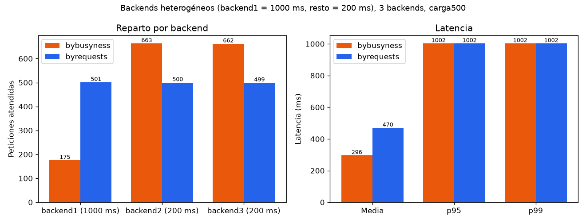

# Análisis de resultados

## Resultados confiables
- 24 ejecuciones (2 algoritmos x 3, 5 y 7 backends x 50, 100, 500 y 1000 usuarios), 29.700 peticiones en total y 0 errores.
- Excluyendo byrequests con 5 backends, la latencia media queda entre 202 y 216 ms y el p95 entre 206,5 y 257,3 ms. El piso de ~200 ms corresponde al trabajo simulado en `/work`, así que el sobrecosto del balanceador es de pocos milisegundos.
- El p99 es más variable que el p95 (214,9 a 608 ms en esas mismas ejecuciones): es sensible a picos aislados.
- Reparto: byrequests fue exacto con 3 y 5 backends (0 % de desbalance). bybusyness mostró desviaciones pequeñas con 3 backends (hasta 5,4 %). Con 7 backends y pocas peticiones, la desviación (hasta 4,67 %) es de redondeo, porque 150 peticiones no se dividen en partes iguales entre 7.

## Lo que no se puede concluir
- Que un algoritmo sea mejor que otro en latencia: con backends iguales y sin saturación las diferencias son pequeñas, y las ejecuciones de byrequests con 5 backends no son confiables.
- Que más backends aumenten la capacidad: el throughput coincidió con la carga ofrecida (≈5, 10, 49 y 98 req/s), es decir, nunca se llegó al límite del sistema.

## Limitaciones
- Los N usuarios virtuales llegan repartidos en 30 s; no son N usuarios simultáneos.
- bybusyness no equivale a least_conn.
- Las ejecuciones de byrequests con 5 backends muestran mediciones anómalas (latencia mínima negativa con 500 y 1000 usuarios, p99 de 1720 ms con 100 usuarios) y no se repitieron. En las gráficas esos puntos deben leerse con esta reserva.
- **Las pausas entre peticiones no se aplicaron** (comprobado el 16/11/2026, ver también `pruebas/README_PRUEBAS.md`).
  - Qué pasó: `carga.yml` define `think: 0.5` entre las 3 peticiones de cada usuario. Con la versión de Artillery usada, ese valor produce `TimeoutNaNWarning ... Timeout duration was set to 1`: cada pausa duró ~1 ms. El aviso aparece en las 24 de 24 corridas, y la sesión media de cada usuario fue de ~0,67 s (625-935 ms), no de ~1,6 s.
  - Cómo afecta: según la ley de Little (simultáneos ≈ llegadas/s × duración), hubo unos **1, 2, 11 y 23 usuarios simultáneos** en las cargas de 50, 100, 500 y 1000, frente a ~3, 5, 27 y 53 previstos. Las peticiones en curso nunca pasaron de unas 20 entre todos los backends, lo que explica que no se llegara a saturar el sistema.
  - Por qué los resultados siguen siendo válidos como comparación: el defecto es idéntico en todas las corridas (mismo escenario y versión, mismo patrón de peticiones), así que la comparación entre 3/5/7 backends y entre algoritmos es justa. Además, lo que se mide por petición (latencia, errores, reparto) no depende de la pausa. No sirven, en cambio, para conclusiones de capacidad o saturación.
- No se ejecutó la prueba de caída bajo carga con Artillery. La caída y recuperación se probó de forma secuencial (60/60 respuestas correctas con health checks activos), documentada en `balanceador/GUIA_PASO_A_PASO.md`, secciones 11 a 13.

## Pruebas nuevas (16/11/2026): concurrencia real y backends heterogéneos

Se ejecutaron con el sistema actual (cada backend es Apache delante de `app.py`, Artillery 2.0.34) y 3 backends. Los resultados están en `pruebas/resultados/make/`. La tabla y la gráfica se regeneran con `python scripts/graficas_nuevas.py` (requiere matplotlib).

**Importante:** las 24 ejecuciones publicadas en las secciones anteriores (10/11/2026) se midieron **cuando el backend era solo Python** (`app.py` respondiendo directamente en el puerto 80), antes de poner Apache delante. Las pruebas nuevas no son una repetición de aquellas: tienen otro diseño y otro backend. Sirven para comparar entre ellas, no con las publicadas.

| Prueba | Algoritmo | Peticiones | Errores % | Pet./s | Media ms | p95 ms | p99 ms | Sesión media ms | Reparto (backend1 / 2 / 3) |
|---|---|---:|---:|---:|---:|---:|---:|---:|---|
| Concurrencia (~500 simultáneos) | byrequests | 30000 | 0.00 | 317 | 201.7 | 202.4 | 202.4 | 72947.6 | 9997 (33 %) / 10001 (33 %) / 10002 (33 %) |
| Concurrencia (~500 simultáneos) | bybusyness | 30000 | 0.00 | 350 | 201.7 | 202.4 | 202.4 | 72925.6 | 9969 (33 %) / 9983 (33 %) / 10048 (33 %) |
| Heterogénea (backend1 = 1000 ms) | byrequests | 1500 | 0.00 | 34 | 469.5 | 1002.4 | 1002.4 | 1476.5 | 501 (33 %) / 500 (33 %) / 499 (33 %) |
| Heterogénea (backend1 = 1000 ms) | bybusyness | 1500 | 0.00 | 47 | 295.5 | 1002.4 | 1002.4 | 981.6 | 175 (12 %) / 663 (44 %) / 662 (44 %) |

### Concurrencia real (`pruebas/concurrencia.yml`)

- **El escenario es válido.** Sin `TimeoutNaNWarning` (usa `think: 1`) y con una sesión media de ~72,9 s, la esperada (60 × (0,2 s + 1 s)). Durante ~60 s hubo **~500 usuarios simultáneos** y unas 80 peticiones en curso, frente a ~23 y ~20 en la prueba publicada de "1000 usuarios".
- **El sistema no se saturó ni con 500 usuarios simultáneos.** 30 000 peticiones por algoritmo, 0 errores, latencia plana (media 201,7 ms y p95 202,4 ms, el piso de 200 ms del trabajo simulado) y reparto exacto a un tercio. El trabajo de `/work` es una espera, no CPU, así que cada backend atiende muchas peticiones a la vez sin degradarse. El límite real del sistema sigue sin medirse.
- **Con backends iguales, los dos algoritmos dan lo mismo.** La diferencia de peticiones/s (317 frente a 350) viene de cómo Artillery promedia la tasa por ventanas de 10 s, incluida la llegada de usuarios: ambas corridas hicieron las mismas 30 000 peticiones en el mismo tiempo.

### Backends heterogéneos (`pruebas/compose.heterogeneo.yml`)

- **`byrequests` reparte por turnos y no mira la carga:** `backend1` recibe un tercio de las peticiones (501) aunque tarda 5 veces más. La media sube a 470 ms y cada usuario tarda 1,48 s.
- **`bybusyness` envía cada petición al miembro con menos peticiones activas.** Como las peticiones de `backend1` duran 1 s, ese backend acumula peticiones abiertas y casi siempre aparece como el más ocupado, así que recibe solo el **12 %** (175). No llega a 0 porque, cuando los tres tienen las mismas peticiones activas (por ejemplo, ninguna), Apache desempata por turnos, igual que `byrequests`.
- **Resultado:** con `bybusyness`, la latencia media baja un **37 %** (470 → 296 ms) y la sesión de cada usuario un **34 %** (1,48 → 0,98 s), sin errores.
- **El p95 y el p99 son iguales (1002 ms) con los dos algoritmos.** Aunque `bybusyness` reduce las peticiones lentas al 12 %, eso sigue siendo más del 5 %, así que el percentil 95 cae dentro de las peticiones de 1000 ms. La mejora se ve en la media y en la proporción de peticiones lentas, no en el p95.
- **Conclusión:** con backends de distinta capacidad, `bybusyness` adapta el reparto a la carga real y mejora el tiempo de respuesta medio. Con backends iguales no hay diferencia apreciable.

### Limitaciones de estas pruebas

- Una sola ejecución por configuración, sin repeticiones: los resultados son indicativos.
- Solo 3 backends y una carga por escenario.
- La heterogeneidad es simulada (`WORK_DELAY_MS` mayor en un backend): representa un servidor más lento, no uno con menos CPU.
